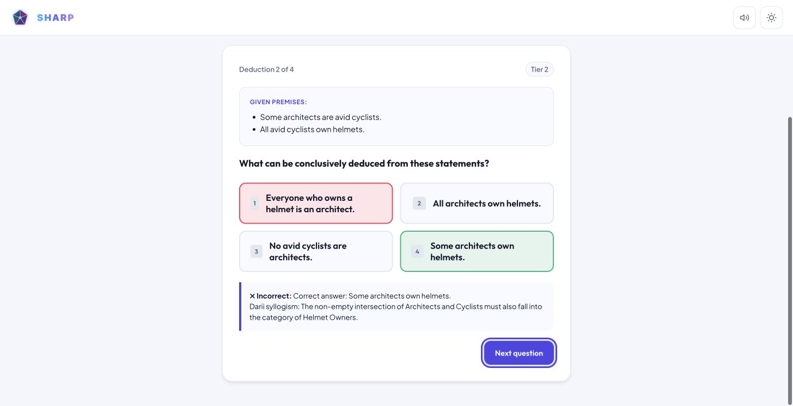

# Feedback and keyboard continuation

Date: 2026-10-19. This is the first UX stage after the reliability foundation. It completes part of Phase 1; workout checkpoints, interruption recovery, cross-tab ownership, navigation redesign and dialog improvements remain pending.

## Behavior

Math, logic and comprehension now keep answer feedback on screen until the player chooses **Next question**, or **View results** for the final item. Reading an explanation no longer consumes a fixed one- or two-and-a-half-second interval. Time spent reading feedback is outside the next question's response timer.

Each answer can be submitted once. Choices become unavailable after answering, while their text remains readable. Incorrect logic and comprehension feedback explicitly identifies the correct answer, alongside the explanation. Math displays its authored explanation or the correct numeric answer for procedural items.

Focus moves to the continuation button after an answer, to the first option of the next question, and to the result heading after the final item. Route navigation focuses the new view heading. Option groups are named by their question, and feedback has a status role. A player can answer with `1`–`4` and continue with Enter. Number shortcuts are removed while feedback is shown; repeated clicks and held Enter/Space activation are guarded against skipping questions.

## Validation

- The existing **39/39** automated tests pass, including scoped listener cancellation, once-only completion, route cleanup, import/restore integrity and offline manifest coverage.
- JavaScript syntax, manifest freshness and whitespace checks pass.
- Desktop Chrome checks cover persistent feedback, keyboard continuation, question focus and result focus. Complete logic, comprehension and arithmetic flows reach results through their explicit continuation buttons. Holding Enter while continuing left the next question unanswered, with its first option focused.
- The offline manifest is regenerated with this stage, so updated game modules and styles are installed as one snapshot.

The screenshot is a desktop smoke-check artifact. Round summaries and rating changes still commit when View results is chosen; leaving a quiz before that point does not resume it. Durable answer/checkpoint recovery is the next stage. Screen-reader testing and physical-device qualification remain pending; focus and status markup alone do not establish full accessibility conformance.
