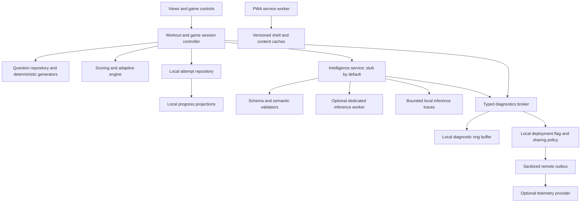

# Sharp redesign: implementation analysis and delivery plan

- Date: 2026-10-19
- Status: Proposed implementation plan; application code is unchanged
- Repository baseline: `b00082fa6f423bf8e056e6913fdc1af912d71961` (`sharp@0.1.0`)

Navigation: [Requirements](#2-source-requirements-and-interpretation) · [Research corrections](#3-corrections-to-the-supplied-research) · [Repository findings](#4-repository-findings-that-affect-delivery) · [UX and games](#5-product-and-interaction-design) · [Architecture](#6-target-architecture) · [Storage](#7-persistence-migration-and-backup) · [Content](#8-content-model-curriculum-and-trusted-answers) · [Player analytics](#9-local-progress-analytics-and-adaptive-behavior) · [Intelligence](#10-browser-intelligence-stub-first-measured-activation-later) · [Developer telemetry](#11-developer-observability-central-upload-and-sensitive-values) · [Evaluations](#12-prompt-evaluation-and-developer-feedback-loop) · [Reminders](#13-reminders-and-notifications-under-static-hosting) · [Delivery](#14-delivery-plan-and-acceptance-criteria) · [File map](#15-file-level-implementation-map) · [Validation](#16-validation-matrix-and-release-budgets) · [Decisions](#17-decisions-risks-and-the-first-implementation-pr)

## 1. Recommended direction

Improve Sharp in two releases. First, make the existing offline training experience reliable, easier to use, and measurable, with a larger verified curriculum and an intelligence interface that returns deterministic fixtures. Then introduce optional browser inference after device benchmarks and prompt evaluations pass. Keep remote developer telemetry disabled in both releases until its separate activation criteria pass.

The shared conversation is a useful requirements brief, but its proposed implementation should not be adopted directly. It contains browser compatibility errors, unsupported notification promises, overstated security guarantees, and an evaluation threshold that can hide serious failures. The most important architectural decision is to keep validated content, scoring, persistence, and workout completion independent of model execution.

The resulting product should have these properties:

1. A player can start a useful workout immediately, offline, without a model, notification permission, or remote analytics.
2. A resumed or interrupted game cannot silently record a false completion, duplicate a rating update, or lose an active memory task.
3. Every scored question has a known answer and a versioned validation path. A model never becomes the authority for correctness.
4. Player progress stays local. Developer diagnostics use a separate, explicit, initially disabled export/upload policy.
5. Browser intelligence is optional, bounded, cancellable, and recoverable. Its failure produces a curated fallback.
6. Prompt changes require inspectable evaluations against the previous release. Golden failures remain release blockers unless their expected behavior is deliberately reviewed and revised.

These are implementation recommendations, not features already present in Sharp. Numerical budgets and content targets below are proposed acceptance targets, not measured hardware limits or quality claims.

## 2. Source requirements and interpretation

Primary source: [full Gemini conversation](https://share.gemini.google/rLMnG8Sa7WWA), titled “PWA Redesign and Local LLM Integration Plan.” The [original shared link](https://share.gemini.google/FX2Cl1muQcX1) identifies the same topic; the full conversation supplies the later clarification about remote developer analytics. The full conversation was read in the browser, including the original request, initial research report, telemetry clarification, and revised report.

The user's later clarification takes precedence over the report's local-export-only telemetry design: player analytics remain local; developer diagnostics should eventually reach a central service, initially for LLM features and later for app health, behind a disabled flag.

| Requirement from the conversation | Implementation interpretation | Delivery point |
| --- | --- | --- |
| Significantly improve UX and accessibility | Short onboarding, clear daily action, resumable sessions, explicit feedback progression, accessible controls and charts | Core release |
| Better games and a much larger question database | Expand verified content and deterministic generators before adding model-generated scored content | Core release, then ongoing |
| Rich analytics using accuracy, time, and patterns | Persist attempt-level evidence; compute comparable local summaries with sample sizes | Core release |
| No intelligent features in initial versions; prepare the engine | Ship a provider interface, stub, prompt registry, cache contracts, and trace schema with inference disabled | Core release |
| Everything local; GitHub Pages; no server dependency | No server required for training, persistence, scoring, or inference. Initial model downloads require network access | All releases |
| Central developer analytics, disabled for now | An optional outbound diagnostics integration is permitted by the later clarification; it is never a dependency of training | Prepared in core; activated separately |
| Langfuse Hobby/free tier preferred unless a better fit exists | Retain Langfuse for developer-side evaluation/import; prefer PostHog as a future direct-browser diagnostics sink | See section 11 |
| Save browser model I/O to improve prompts | Bounded local traces plus a separately gated, sanitized remote trace payload; device-local export remains available | Stub first; uploads later |
| No prompt regressions or unreliable behavior | Hard correctness/contract gates, repeat runs, holdout cases, production fallback, and reviewed baseline changes | Before inference activation |
| Persistent data across sessions and days | IndexedDB migration, honest durability indicators, portable backup, and recovery tests | Core release |
| Notifications and related permissions up front | Explain capabilities during first run; invoke native requests only after a relevant user action and only where useful | Core release |
| Unsupported-browser notice | Show an upfront capability notice; recommend a tested browser for intelligence while keeping baseline training usable | Core release |
| iPhone 14/15/17 Pro, MacBook Pro 14 M5, MacBook Air 13 M1 | Physical-device qualification matrix, including browser/OS version and installed PWA mode | Before capability claims |

The source says “supported browser/platform” when asking that users be prompted to move. This plan interprets that as **unsupported**. It also treats Chrome as the primary desktop/Android target and includes iOS Chrome plus installed iOS web apps in qualification. Safari is a useful additional Apple validation target; a claim of Chrome parity on iOS must come from testing, not its brand name.

### Decisions this plan deliberately changes

- Keep the existing deterministic rating engine; place model prompting in a separate intelligence service.
- Keep curated questions and generators as the production foundation.
- Gate intelligence capabilities rather than blocking the entire application on `navigator.gpu`.
- Use a dedicated Web Worker for foreground inference; keep the PWA service worker responsible for offline assets and notification handling.
- Treat local encryption as a limited storage control, not protection from compromised same-origin JavaScript.
- Use local deployment flags before any third-party SDK initialization. A vendor flag is not sufficient to establish zero telemetry traffic.
- Offer feasible reminder options instead of promising scheduled offline web push.

## 3. Corrections to the supplied research

| Proposal or claim in the report | Assessment | Correct implementation consequence |
| --- | --- | --- |
| Safari 18+ fully supports WebGPU; “Safari 26+ on iOS 18+” | The version claims are inconsistent. WebKit documents WebGPU shipping in Safari 26 | Use feature probes and an actual tested OS/browser matrix; do not publish those earlier minimums |
| Presence of `navigator.gpu` proves the app can run its model | Insufficient: adapter creation, required features, buffer limits, allocation, and inference can still fail | Probe in stages and retain deterministic fallback |
| Block all app initialization without WebGPU | Conflicts with the initial non-LLM release and removes working training features | Explain that optional intelligence is unavailable; allow core training |
| Device name reliably determines available model memory | No portable API gives a reliable per-tab allocatable GPU memory budget | Use conservative profiles and a bounded warm-up; measure actual devices |
| SmolLM2 360M needs about 130 MB VRAM | Understates the current WebLLM registry estimate, which lists about 376 MB for its q4f16 variant at the configured context | Distinguish weight download size, registry estimate, and observed peak usage |
| Service-worker heartbeats guarantee a live inference engine | WebLLM explicitly warns that the browser can still terminate the service worker | Avoid coupling inference to the offline service worker; handle termination |
| `json_object` guarantees the application schema and correct answers | JSON syntax is not semantic validity, answer uniqueness, or pedagogical quality | Apply a schema, task-specific validators, and trusted scoring |
| A 98% aggregate evaluation score guarantees no regressions | An average can conceal wrong answers, inaccessible UI, or an entire failing device slice | Use independent hard gates and per-slice comparisons |
| `persist()` guarantees data survives indefinitely | Persistence requests are heuristic and may fail; users can clear storage | Record the actual result and maintain portable backups |
| A non-extractable CryptoKey prevents malicious scripts from reading protected data | It restricts key export, not authorized decryption by code running with access to the key | Prioritize injection prevention, origin isolation, and restricted data collection |
| A hidden developer route or hash protects exports | Client code and storage are inspectable; a hidden route is not authentication | Provide an explicit local diagnostics/export screen; never put admin secrets in it |
| PostHog feature flag off means no network requests | SDK initialization and flag evaluation can themselves contact the vendor | Do not load or initialize the transport while local flags are false |
| Local service worker uses Web Alarm/background sync for exact offline reminders | No portable PWA alarm mechanism satisfies this across the target devices; periodic sync timing is browser-controlled | In-app reminders plus calendar/OS reminder handoff; remote push or native scheduling requires a separate scope decision |
| More haptics will improve the main Apple target uniformly | Support varies; vibration must remain optional | Preserve equivalent visible feedback; never encode correctness only through haptics |

Primary verification: [WebKit's Safari 26 release notes](https://webkit.org/blog/17333/webkit-features-in-safari-26-0/), [WebLLM worker and cache documentation](https://webllm.mlc.ai/docs/user/advanced_usage.html), [Chrome's periodic background sync constraints](https://developer.chrome.com/docs/capabilities/periodic-background-sync), and [WebKit storage policy](https://webkit.org/blog/14403/updates-to-storage-policy/) support these browser corrections. The encryption limitation follows the [Web Cryptography security considerations](https://www.w3.org/TR/WebCryptoAPI/#security-considerations). The proposed architecture and gates are Sharp-specific recommendations derived from those constraints.

## 4. Repository findings that affect delivery

This review used source inspection, the existing Node test suite, and small isolated Node probes. It did not run a rendered UX/accessibility audit or model benchmarks. UI recommendations below require browser and assistive-technology verification during implementation.

Baseline verification: `npm test` passed **16/16 tests** on 2026-10-19. The runner emitted an environment warning about Node's localStorage availability; the storage layer supports an in-memory fallback. The passing tests do not cover the failure modes below.

| Priority | Evidence in current code | Consequence and required work |
| --- | --- | --- |
| P0 | [`sw.js`](../sw.js), `STATIC_ASSETS`, omits `data/questions-db.js` and all four `data/domains/*.js` modules | Cold offline readiness is incomplete. Runtime caching may fill the gap after online use, but precaching does not establish a complete app dependency graph |
| P0 | `sw.js` activation deletes every cache except its two current cache names | It can delete future WebLLM caches and unrelated same-origin application caches. Delete only obsolete caches owned by Sharp's shell |
| P0 | `sw.js` revalidates individual cached modules and calls `skipWaiting()` immediately | App versions can mix during a workout. Use revisioned assets and a coherent release/update boundary |
| P0 | [`js/router.js`](../js/router.js) checks `activeCleanup` but never assigns a view/game cleanup result | Timers and document listeners can survive navigation. Every mounted view needs a cleanup contract |
| P0 | Logic, comprehension, math, pattern, and Corsi modules use untracked timeouts | A departed game can continue work against detached DOM or persist results. Cancel resources and reject stale callbacks |
| P0 | [`js/backup.js`](../js/backup.js), `validateAndMigrateBackup()`, accepts a checksum mismatch and a future schema version | Confirmed by isolated probes. Restore validation needs rejection, version negotiation, and staging before replacement |
| P0 | `applyBackup()` clears existing data before per-key saves and ignores save failures | A quota/write failure can leave a partial restore. Validate and commit transactionally with a recovery path |
| P0 | [`data/questions-db.js`](../data/questions-db.js), `importQuestionPack()`, uses a truthiness check on `correctAnswer` | A valid numeric answer of `0` is rejected; confirmed by a probe. Validate presence and type explicitly |
| P0 | Imported questions may override built-in IDs and pass through HTML template interpolation | Untrusted content can alter answers or reach unsafe rendering sinks. Separate namespaces, validate fields, and render text safely |
| P1 | Dataset count is 24 questions: 11 logic, 8 math, 5 comprehension; 4 memory clusters | Current variety is small. This is separate from procedural arithmetic/story generators |
| P1 | `getQuestionsByDomain()` sorts by nearest tier and usage; no skill/category/exclusion contract | Story Math can select arithmetic-category math records. Repeats and difficulty jumps need explicit selection policy |
| P1 | `getMemoryCluster()` always selects the closest cluster; custom memory clusters are outside the normal import path | The same study items can recur. Add memory-item scheduling and a real memory-pack contract |
| P1 | [`js/analytics.js`](../js/analytics.js) stores round summaries, caps them at 1,000, and averages round percentages equally | It cannot support detailed error-pattern analysis or correctly weight sessions with different question counts |
| P1 | `renderTrendLineSVG()` averages `ratingAfter` across the domains played that day | This is not the five-domain overall score. Reconstruct daily domain snapshots before charting an overall trend |
| P1 | Streaks, workouts, backups, and chart dates use UTC string slicing; prompts mix that with local hours | Local evening/day boundaries and DST are inconsistent. Introduce one local calendar-day policy |
| P1 | [`js/views/settings-view.js`](../js/views/settings-view.js) saves morning/evening times; [`js/notifications.js`](../js/notifications.js) has no scheduled dispatcher | The saved settings do not establish background reminders. Current prompts are checked from app startup |
| P1 | Choice handlers attach document listeners with `{ once: true }`; pointer answers do not explicitly remove them | An unrelated key can consume a shortcut listener, and stale closures can persist. Scope shortcuts to the active question |
| P1 | Feedback in logic/comprehension advances after a fixed timeout | Players may lose the explanation before reading it. Use explicit Next with focus management |
| P1 | [`js/modal.js`](../js/modal.js) sets initial focus but has no focus trap/return-focus contract; nav links use tab semantics | Prefer native dialog behavior and ordinary navigation semantics, or implement the full tab interaction pattern |
| P2 | [`css/styles.css`](../css/styles.css) imports Google Fonts | The current “zero external servers” wording is too broad. Self-host fonts or use system fonts for a fully self-contained shell |

The existing documentation also overstates some behavior. [`ARCHITECTURE.md`](../ARCHITECTURE.md) says datasets are precached, checksum validation is enforced, and migrations are available. Actual migration code is a placeholder; the checksum implementation is a DJB2-style rolling hash, not the described FNV-1a. Update the architecture and README alongside each implemented contract rather than treating those statements as evidence of functionality.

## 5. Product and interaction design

### 5.1 Information architecture

Use three primary destinations: **Today**, **Exercises**, and **Progress**. Place Backup, Reminders, Privacy/Diagnostics, Accessibility, and Intelligence under Settings. Preserve redirects for the existing hash URLs so bookmarks and notification links continue working.

Today should show one recommended next action with an honest duration, current circuit progress, and a separate time-capsule recall card when due. Do not require reading a radar chart or managing a model download before starting. Treat streaks as encouragement; show missed-day recovery without punitive messaging.

The workout controller should own a durable state machine:

```text
planned -> in_progress -> round_complete -> next_round -> completed
                  |                              |
                  +-> paused -> resumed           +-> completed_once
                  +-> abandoned
```

Persist `workoutId`, local day, exercise sequence/version, completed round IDs, current checkpoint, and completion status. Derive completion from committed rounds. Do not increment a streak merely because a result screen rendered. Resume after reload; an interrupted timed sequence restarts that sequence and records the interruption separately from a wrong answer.

### 5.2 First-run flow

1. Explain that training works offline after setup and progress lives on this device.
2. Show any actionable capability limitation up front. Explain which optional feature is affected and offer a tested-browser recommendation.
3. Offer a short practice workout and a dismissible reminder setup action. On iOS, show installation instructions when required for the relevant capability.
4. Request persistence after explaining local data durability; report “protected storage requested/granted” accurately. It is not a guarantee of backup.
5. Offer notification permission only from an explicit action with a working notification use case. Do not ask for unavailable scheduled alerts in the initial static-only release.
6. Offer model installation later, when inference is enabled and the user chooses it. Show actual download size and a cancel action.

This satisfies the intent to discuss permissions early without making native permission grants a condition of entry. Do not request unrelated camera, microphone, location, or clipboard permissions.

### 5.3 Shared game experience

- Introduce the task with one worked example and an untimed practice option.
- Keep an accessible exit/pause control available during focus mode. If navigation visually collapses, its hidden controls must leave keyboard focus order too.
- Show one challenge at a time. Confirm the answer, reveal the explanation and distractor rationale, then let the player choose Next.
- Use a single session component for progress, feedback, pause, and completion. Domain-specific interaction remains inside the game module.
- Scope shortcuts to the active question and ignore editable inputs. Explain shortcuts without requiring them.
- On navigation, cancel timers, listeners, animation frames, and inference requests. Guard every result with its active session/request ID.
- Persist rating/progress updates once per committed round. A repeated callback or refresh must not double-apply results.

### 5.4 Accessibility requirements

Target WCAG 2.2 AA across the supported experience, retaining stronger text contrast where practical. The report's AAA contrast numbers are a useful enhancement target, but contrast alone is not AAA conformance. Include visible focus, keyboard operation, timing alternatives where compatible with the task, reflow, accessible names, and status announcements. [WCAG 2.2](https://www.w3.org/TR/WCAG22/) defines these requirements beyond color contrast.

Use semantic buttons for choices and grid cells; add position/state labels and predictable arrow-key navigation where appropriate. Avoid reading every rapid animation frame through a live region. Announce phase changes and results. Provide a text/table counterpart to charts and patterns that can be made equivalent. Where a visual task has no equivalent nonvisual assessment, offer an alternative exercise and label its score separately rather than claiming identical measurement.

Check at 200% zoom, narrow mobile widths, large text, both themes, reduced motion, keyboard-only input, VoiceOver on actual iPhone/macOS, and TalkBack on the secondary Android target. Preserve text feedback when sound or vibration is absent. Do not force a new palette: evolve the existing tokens in [`DESIGN_LANGUAGE.md`](../DESIGN_LANGUAGE.md) and validate rendered states, not only token pairs.

### 5.5 Game roadmap

| Order | Exercise work | Training interaction | Verification and analytics |
| --- | --- | --- | --- |
| 1 | Repair and diversify current math, logic, comprehension | Broader skills, worked feedback, fewer repeats | Solvers/reference answers, option uniqueness, reading and response time separated |
| 1 | Improve Time-Capsule Recall | Rotate items; preserve exact study set and actual retention interval; distinguish free recall from recognition | Recall precision/coverage, false recognition, delay bucket, study exposure |
| 1 | Improve Pattern Flash and Corsi | Practice mode, robust interruption handling, deterministic seed replay, forward/reverse modes clearly labeled | Sequence span, order/cell errors, false alarms, interruption status |
| 2 | Rule switching / inhibition | Alternate a visible sorting rule; optional go/no-go variant | Switch cost, false alarms, omissions; device/input latency caveats |
| 2 | Constraint ordering and relational logic | Construct or select a valid ordering | Enumerate satisfying assignments and prove the requested answer |
| 3 | N-back or additional working-memory variants | Separate, optional exercise after instruction and usability validation | Hit rate/false alarms; do not combine scores blindly with Corsi |

These are practice tasks, not validated medical or intelligence assessments. Avoid copy such as “psychometric diagnosis” or promises of general cognitive improvement without evidence. Rank new games by usability and validated content coverage rather than the ease of generating questions with a model.

## 6. Target architecture

Keep the existing vanilla ES module application. A framework rewrite is unnecessary for this scope. Add a reproducible dependency/build step when bundling the worker and any vendor SDK becomes necessary; deploy only static output to GitHub Pages. Pin dependencies and preserve a fast no-model boot path.



The proposed responsibilities are:

| Boundary | Owns | Must not own |
| --- | --- | --- |
| Session controller | Lifecycle, state transitions, cancellation, commit IDs, resume | Model internals or vendor telemetry configuration |
| Content repository | Validated packs, generation selection, item scheduling | DOM rendering or user-rating mutation |
| Adaptive engine | Deterministic difficulty decisions and versioned rating calculations | Prompts or model downloads |
| Persistence repositories | Transactions, migrations, recovery, typed queries | Hidden network uploads |
| Progress projections | Local metric definitions and daily snapshots | Vendor event ingestion semantics |
| Intelligence service | Provider lifecycle, prompt registry, deadlines, cache, validation, fallback | Final answer authority or streak completion |
| Diagnostics broker | Allowlisted events, local recording, redaction, routing | Uploading player history wholesale |
| Transport adapter | Batches, retry/backoff, delivery IDs, provider mapping | Deciding which player data is shareable |
| PWA service worker | Shell install/update/offline fetch and notification clicks | Long-lived inference or reliable wall-clock scheduling |

Suggested directories, introduced incrementally:

```text
js/
  core/              capabilities.js, feature-flags.js, calendar.js, session-controller.js
  persistence/       db.js, migrations.js, attempts.js, workouts.js, content.js
  content/           schema.js, selection.js, validators/, generators/
  progress/          metrics.js, projections.js
  intelligence/      service.js, stub-provider.js, webllm-provider.js, inference-worker.js
                     prompt-registry.js, cache.js, model-manifest.js
  observability/     events.js, broker.js, redaction.js, outbox.js, providers/
data/
  packs/             versioned reviewed content packs and pack manifests
prompts/             versioned task templates and output contracts
evals/               golden/, holdout/, rubrics/, baselines/, providers/
scripts/             validate-content.mjs, import-diagnostics.mjs, run-browser-evals.mjs
test/                focused logic and persistence tests
test/browser/        lifecycle, offline, accessibility, telemetry policy tests
```

Names are proposed, not existing APIs. Preserve compatibility wrappers around current storage/content APIs while migrating one caller at a time; do not combine directory moves with all behavioral changes in one PR.

## 7. Persistence, migration, and backup

### 7.1 Storage layout

Use IndexedDB for growing structured records and transactional session commits. Keep localStorage only for small synchronous boot preferences such as theme and the migration locator. Use Cache Storage for replaceable shell/model artifacts; do not put model weights inside progress backups.

| IndexedDB store | Primary identity / useful indexes | Retention policy |
| --- | --- | --- |
| `profile` / `preferences` | Singleton/versioned settings | Until reset or restore |
| `workouts` | `workoutId`; local day, status | Durable completion records; prune old checkpoints |
| `attempts` | `attemptId`; session, question/version, domain, occurredAt | Raw evidence retained to a configurable cap; aggregate older periods before pruning |
| `rounds` | `roundId`; session, domain, completedAt | Durable summaries and rating provenance |
| `ratings` | Domain; algorithm version | Current state plus snapshots/history |
| `delayedMemory` | Session ID; status, readyAt | Preserve committed study content until completion/explicit reset |
| `contentPacks` / `questions` | Pack ID/version; domain, skill, tier | Installed pack policy; reviewed content never overwritten implicitly |
| `questionStats` | Question ID plus content version | Rebuildable from available attempts where possible |
| `dailyProgress` | Local date plus calendar policy version | Long-term local projections |
| `inferenceTraces` | Trace ID; task, status, prompt/model version | Proposed: 7 days or 20 MiB, whichever limit is reached first |
| `diagnostics` | Event ID; severity, occurredAt | Proposed: 7 days or 5 MiB |
| `remoteOutbox` | Delivery ID; nextAttemptAt | Empty while sharing is disabled; proposed 72-hour expiry and 5 MiB cap when enabled |
| `migrationState` | Migration ID and source digest | Keep completion/recovery metadata |
| `keys` | Key ID, version, purpose | Only if local trace encryption is implemented |

Caps above are starting policies. Show storage usage, persistence status, data export, and separate actions for deleting models, diagnostics, and all progress. Prune replaceable diagnostics/generated caches before valuable player progress. WebKit exposes estimated usage/quota and uses heuristics for persistence grants; capacity is not an allocation promise. [WebKit storage policy](https://webkit.org/blog/14403/updates-to-storage-policy/) explains this distinction.

### 7.2 Migration from schema v1

1. Read every current `sharp:*` record, including `profile`, `daily_workout`, custom questions, and question stats. Capture an immutable source snapshot and digest.
2. Validate shape, normalize missing fields, and quarantine invalid custom records. Present repair information without silently converting corrupt data into successful attempts.
3. Open the new database and write transformed records under a migration transaction/checkpoint. Preserve existing session IDs where available; use stable migration IDs for missing identities.
4. Mark legacy history as **round-level evidence**. It cannot be expanded into genuine per-question timings, skill errors, or attempts.
5. Preserve legacy day labels with a UTC legacy marker. Historical local dates cannot always be recovered accurately; do not invent them.
6. Compare counts, ratings, active memory content, streak state, and checksums. Mark the migration committed only after successful verification.
7. Switch reads to IndexedDB. Retain the source snapshot until a successful reload and user-export opportunity; retire old data under a documented cleanup policy.
8. Make repeat execution idempotent. On failure, return to the intact legacy store or a clear recovery screen. Never clear legacy data before verification.

Handle `versionchange` by closing stale database connections and requesting a safe reload in other tabs. Use a cross-tab ownership/notification mechanism, with a tested fallback, to avoid two active workout controllers committing the same state. Unique round/attempt keys plus an IndexedDB transaction provide the final duplicate-write defense; a UI lock alone is insufficient.

### 7.3 Backup contract v2

Provide two distinct exports: **Progress backup** and **Diagnostics bundle**. The former includes local progress/settings/custom content and active recall sessions. The latter contains selected diagnostics/traces and an export manifest. Neither includes vendor secrets, model weights, browser CryptoKey handles, or an automatic upload instruction.

Backup v2 should include `backupFormatVersion`, data schema version, app version, export timestamp, checksum algorithm, digest over a specified canonical representation, and validated records. Use SHA-256 for accidental corruption detection; an unkeyed checksum is not proof of authenticity. Keep a compatibility reader for v1 exports. Existing v1 files with no checksum can be offered an explicitly labeled legacy import path; present-but-invalid checksums should be rejected.

Reject unsupported future schemas and malformed record types. Preview changes before restore, stage all records, and commit atomically. A failed restore must leave the previous state readable. Test quota failures and interrupted imports.

For merge, deduplicate attempts/rounds by immutable identity, detect conflicting payloads, and rebuild derived projections. Do not take the maximum rating or current streak from each backup: those values can be inconsistent with merged history. If legacy records cannot reproduce a rating, preserve a labeled snapshot and apply an explicit conflict policy.

Portable encrypted export needs its own recovery design: for example, a user passphrase derives a separate export key using a reviewed Web Crypto KDF configuration with a random salt, recorded parameters, and authenticated encryption. Do not export ciphertext that depends only on a non-extractable key left behind on the original device. Plain JSON export should clearly identify its contents before download.

## 8. Content model, curriculum, and trusted answers

### 8.1 Separate content from player state

The existing schema already has useful fields: domain, category, skill, tier, expected time, hints, distractor rationales, and tags. Expand it without embedding a player's competency or live usage counters in immutable question records. Content, attempts, statistics, and prompt context have different lifecycles.

Use stable option IDs instead of matching visible answer strings. This avoids string/number comparisons, duplicate visible answers, and HTML in `data-val` attributes. Store answer/scoring rules separately from rendering fields. A proposed scored-item shape is:

```json
{
  "schemaVersion": 2,
  "id": "sharp.math.inventory.0001",
  "contentVersion": 1,
  "packId": "sharp-core-math-en-v2",
  "domain": "math",
  "gameType": "story-math",
  "skillIds": ["multi_step_arithmetic", "ignore_irrelevant_quantity"],
  "difficulty": {
    "tier": 2,
    "steps": 3,
    "workingMemoryItems": 3,
    "readingLoad": "short"
  },
  "presentation": {
    "locale": "en",
    "title": "Fruit inventory",
    "promptText": "A basket starts with 18 apples. Seven are removed. Three apples and five pears are added. How many apples remain?",
    "options": [
      {"id": "a", "text": "14"},
      {"id": "b", "text": "19"},
      {"id": "c", "text": "11"},
      {"id": "d", "text": "16"}
    ]
  },
  "scoring": {"type": "single_choice", "correctOptionId": "a"},
  "solution": {
    "steps": ["18 minus 7 is 11.", "11 plus 3 is 14.", "Pears do not change the apple count."],
    "distractorMisconceptions": {"b": "included_distractor_quantity", "c": "omitted_final_step"}
  },
  "timing": {"expectedResponseMs": 25000, "readingPhaseSeparate": true},
  "provenance": {"origin": "curated", "license": "project-owned", "reviewStatus": "approved"},
  "validation": {"validatorId": "inventory-v1", "status": "verified"},
  "tags": ["inventory", "multi-step"]
}
```

This is an illustrative record, not a complete JSON Schema. Memory clusters, sequences, and visual patterns need discriminated schemas with their own stimulus/scoring fields. Retain mappings from legacy question IDs so stats and exports remain attributable.

Additional metadata should include source attribution/license where applicable, author/reviewer, revision notes, estimated exposure length, accessibility alternatives, misconception IDs, generator/seed/proof data, locale, and content fingerprint. Generated records also need prompt version, model artifact identity, generation parameters, and validator version. Exclude fields with no concrete consumer.

### 8.2 Validation and safe rendering

Validate on pack creation, import, cache insertion, and use. Enforce allowed domains/game types, finite numeric ranges, option-ID uniqueness, exactly one correct option for single-choice questions, reference integrity, text-length limits, and required explanations. Reject arbitrary HTML, scriptable URLs, unexpected executable fields, and prototype-sensitive keys. Cap file size, item count, and nesting depth before expensive work.

Use `textContent`/DOM construction for imported and generated text. Existing trusted authored formatting can migrate to a small structured rich-text representation; do not widen the HTML allowance to accommodate models. A schema-valid question can still be wrong, so each supported generated task also needs a semantic check:

| Task | Trusted check |
| --- | --- |
| Arithmetic and story math | Generate an expression/quantity model and compute the answer independently; use exact rational arithmetic where needed |
| Ordering constraints | Enumerate allowed arrangements; prove the question has the intended unique answer |
| Conditional/truth-table logic | Evaluate formal propositions under a defined finite model |
| Categorical syllogisms | Use a defined logic with explicit existential assumptions; do not substitute real-world intuition |
| Visual patterns/Corsi | Seeded stimulus, exact sequence/grid identity, explicit partial-credit rule |
| Comprehension | Reviewed passage/question pairs and cited evidence spans; open-ended generated inferences remain unscored until an adequate review path exists |

### 8.3 Expansion targets and item selection

Proposed first curriculum milestone: **300 reviewed scored items** across math, logic, and comprehension, **30 memory clusters**, and deterministic arithmetic/pattern/sequence generation. Aim for at least ten reviewed items per priority skill/tier combination; publish coverage gaps rather than filling them with unverified text. Broaden toward 1,000 items after review throughput and error reports are stable. These are editorial targets, not existing inventory.

Selection should filter by game type, skill, tier, locale, validation status, and accessibility mode before ranking. Rank by due review, recent exposure, difficulty distance, and misconception practice. Record the selected item/version and the reason. Use seeded, unbiased shuffling; exclude IDs already served in the current session. If exact-tier content is exhausted, choose a documented nearby tier and display it accurately.

Move repeated memory items through an explicit exposure schedule. Track item-level study and retrieval events, actual delay, recognition versus free recall, and foil errors. Do not mix a three-minute fast track with six-hour retention scores. Preserve a committed study snapshot even if its source pack later updates.

## 9. Local progress analytics and adaptive behavior

### 9.1 Evidence to persist

An attempt should record IDs for attempt/session/round, question/content version, game/domain/skill, presentation mode, tier, selected option or structured response, correctness/partial score, exposure time, active response time, paused/hidden duration, hints/retries, misconception tag where deterministically justified, interruption status, and scoring version. Capture UTC occurrence time plus local date, time-zone identifier, and offset at the event.

Use monotonic timing such as `performance.now()` for within-page durations. Persist checkpoints with wall-clock timestamps for restart detection. A backgrounded tab must not inflate reasoning latency or become an automatic failure. Store read time separately from answer-selection time where the game permits it.

### 9.2 Metric definitions

| Metric | Definition | Presentation rule |
| --- | --- | --- |
| Scored accuracy | Sum of correct eligible attempts / count of eligible attempts | Show numerator/denominator; exclude practice and interrupted attempts |
| Weighted partial score | Sum of earned points / sum of available points | Keep separate from binary accuracy and identify scoring version |
| Response speed | Median and p90 active response time for comparable correct attempts | Segment by game, tier/skill, input mode, and timing policy |
| Learning trend | Recent comparable score/latency versus a prior comparable window | Show sample size and “insufficient data” below a proposed 20 attempts per slice |
| Misconception frequency | Attempts tagged with a specific verified error / eligible attempts testing it | Say “often selects…” rather than diagnosing a cognitive deficit |
| Retention | Recall score grouped by actual delay and retrieval mode | Separate fast-track, same-day, and longer-delay practice |
| Exposure/repetition | Distinct items and repeat intervals per skill | Distinguish new items from mastery review |
| Completion | Completed committed workouts / started workouts | A player-facing local measure; no automatic remote export |
| Streak | Consecutive qualifying local calendar days | One qualification per day; multiple workouts remain separately countable |
| Overall rating | Mean of current ratings for the defined five domains | Reconstruct all domain end-of-day snapshots, including unchanged domains |

Historical summaries should display their available granularity. Do not imply attempt-level confidence for migrated round averages. Do not fabricate zeros for untrained domains or days; label missing evidence.

### 9.3 Adaptation

Keep the current Elo-like formula as a versioned heuristic during the reliability work. Add input guards for invalid/empty sessions and record algorithm version with every rating transition. It is not a calibrated psychometric model simply because its formula resembles Elo/CAT.

Initially use deterministic rules for skill coverage, review scheduling, bounded tier changes, and minimum evidence. Audit speed bonuses so reading accessibility settings, untimed modes, and interruptions do not produce misleading comparisons. Never compare a generated question's claimed tier to a curated tier as if calibrated equally. Experimental generated tasks should be unrated by default until difficulty and answer validation qualify.

The progress screen should lead with a useful observation and supporting counts, then domain trends and recent sessions. Make radar charts optional secondary views. Every insight must be reproducible from stored evidence and tagged with the projection/metric version.

## 10. Browser intelligence: stub first, measured activation later

### 10.1 Framework decision

Use **WebLLM as the first generative runtime candidate**, isolated behind a provider contract. It has dedicated worker support, a compatible chat interface, and structured generation facilities. Use Transformers.js as a benchmark alternative if WebLLM fails a required Apple/browser slice, and as a future option for embeddings/classification. Transformers.js also supports generation; it should not be dismissed as incapable of generative work. Its [WebGPU guide](https://huggingface.co/docs/transformers.js/guides/webgpu) warns that compatibility still depends on model and browser behavior.

A dedicated Web Worker is the proposed default. [WebLLM documents both dedicated and service worker engines](https://webllm.mlc.ai/docs/user/advanced_usage.html), including the termination risk of the latter. A worker improves main-thread scheduling, but it does not eliminate GPU contention or keep running reliably while iOS suspends the app. Cancel or checkpoint optional work on suspension.

Avoid a mandatory CPU/WASM LLM fallback on mobile. The deterministic content provider is the fallback. No local HTTP inference server, cloud model API, browser extension, or proprietary browser-only prompt API is a baseline runtime dependency.

### 10.2 Capability policy

Probe secure context, IndexedDB read/write, worker creation, `navigator.gpu`, `requestAdapter()`, required features such as `shader-f16` for the chosen artifact, relevant adapter limits, device creation, and a bounded real model warm-up. Reuse/destroy probe resources carefully so capability checks do not leave a second GPU allocation alive. A passed probe is advisory, not a promise that later allocations succeed.

Record a coarse local capability report and the reason for any failure. Do not infer exact RAM or device model from a user agent. Expose a conservative recommended profile and let the user remove/disable the model. After repeated allocation/device-loss failure, stop automatic retries for that session and fall back.

### 10.3 Model shortlist and budget

The current upstream registry supplies these indicative values. They are **registry estimates**, not measurements on the listed iPhones or MacBooks, and differ from compressed download sizes. The exact package release may expose a different model list; pin the compatible runtime, weights, tokenizer, compiled library, and manifest revisions together. Source: [WebLLM model registry](https://raw.githubusercontent.com/mlc-ai/web-llm/main/src/config.ts), inspected 2026-10-19.

| Candidate model ID, q4f16 variant | Registry VRAM estimate, MB | Proposed evaluation role |
| --- | ---: | --- |
| `SmolLM2-360M-Instruct-q4f16_1-MLC` | 376.06 | Small-footprint baseline; test short explanations/structured formatting |
| `Llama-3.2-1B-Instruct-q4f16_1-MLC` | 879.04 | Initial phone candidate after physical-device qualification |
| `Qwen2.5-1.5B-Instruct-q4f16_1-MLC` | 1,629.75 | Conservative desktop comparison |
| `gemma-2-2b-it-q4f16_1-MLC` | 1,895.30 | Desktop comparison, including license/distribution review |
| `Qwen3.5-2B-q4f16_1-MLC` | 2,245.44 | Newer desktop challenger; compare task quality and latency |

Do not declare a best model from parameter count or a general leaderboard. The provisional starting candidates are Llama 3.2 1B for a qualified phone and Qwen2.5 1.5B for desktop, with the smaller SmolLM baseline. Select the smallest artifact that passes Sharp's correctness, task-quality, latency, and reliability gates. A newer challenger wins only with evidence on Sharp's workload.

Proposed starting operating budgets:

| Budget | Phone profile | Desktop profile |
| --- | --- | --- |
| Loaded models | One | One |
| Total context | 1,024 tokens initially | 2,048 tokens initially |
| Task output allowance | Up to 256 tokens, included within total context | Up to 512 tokens, included within total context |
| Download target | Aim below 750 MiB; confirm exact artifact bytes | Aim below 1.5 GiB; explicit choice for anything larger |
| Memory target | Approximately 1 GiB inference working set as a qualification target | Approximately 2.5 GiB; test low-memory M1 configuration |
| Foreground concurrency | One request; no automatic chained generation | One request initially |
| Warm task deadline | 10 seconds; curated fallback on expiry | 10 seconds; curated fallback on expiry |
| Cached validated result | Immediate selection, target under 100 ms | Same |
| Model initialization | Separate progress UI; never part of workout-start critical path | Same |

These limits can reject every candidate on a device; that is an acceptable outcome. Memory instrumentation is incomplete in browsers, so combine available tooling with repeat stability, device-loss, and tab-reload observations. Record uncertainty rather than inventing a precise peak value. Report artifact bytes, model load time, TTFT, total task latency, decode rate, and repeated-session stability separately.

### 10.4 Provider and failure contract

The proposed service exposes `getStatus()`, `prepare(profile, options)`, `runTask(request, options)`, `cancel(requestId)`, and `dispose()`. Requests carry a task ID, prompt/output schema versions, sanitized structured input, request/session IDs, and a deadline. Results carry status, validated output if available, source (`stub`, `validated-cache`, `model`, `curated-fallback`), timings, and an error/fallback reason.

State progression:

```text
disabled | unsupported
          eligible -> awaiting_download_choice -> downloading -> loading -> ready
                                                                  ready -> generating -> ready
                 failure/device_lost/evicted -> recoverable_error -> fallback
```

The stub should return versioned fixtures and simulated failure states without importing WebLLM or downloading weights. Test it against the same contract as the future runtime. Core gameplay must tolerate timeout, cancellation, invalid output, missing cache, interrupted download, storage failure, worker termination, and GPU device loss.

First enabled tasks should be low-risk: a short explanation of an already verified solution, or wording variation over a solver-owned template. Any explanation changing numerical facts or the solution is rejected or replaced by authored feedback. Do not start with unrestricted deduction puzzles, answer grading, autonomous difficulty changes, or open-ended comprehension conclusions.

### 10.5 Prompt mechanics and caches

Each prompt bundle should define task purpose, allowed input schema, fixed system template, version/hash, output schema, deterministic validators, supported model profiles, token limits, and fallback content. Keep prompts in reviewable files; do not bury them inside `adaptive-engine.js`.

Supply only necessary facts: selected skill, approved problem structure, verified answer/solution, language constraints, and a coarse difficulty descriptor. Avoid player names, imported free text, exact historical logs, or arbitrary browser state. Treat all imported/question text as data with no authority to alter instructions or trigger tools. The runtime has no tool execution privileges.

Use schema-constrained output where supported by the pinned WebLLM release, followed by independent validation. [WebLLM's structured-generation description](https://blog.mlc.ai/2024/06/13/webllm-a-high-performance-in-browser-llm-inference-engine) distinguishes general JSON mode from schema-driven mode. Limit output length and reject truncation; never render an unfinished streamed question. Streaming may update a loading indicator, but only validated final content becomes a playable item.

Distinguish three caches: model artifacts, compiled prompt/task definitions, and validated generated results. A result-cache key includes task/prompt hash, schema/validator version, model artifact identity, decoding parameters, locale, and canonical input hash. Store only accepted results, cap size/age, invalidate on relevant version changes, and revalidate when reading. Keep generated-question exposure policy independent of cache reuse so a cache hit does not force repeats.

Use the runtime's model cache manager; do not duplicate multi-gigabyte shards into the app runtime cache. Model removal and shell updates must have separate ownership. Show real download progress when available and honest loading phases otherwise; do not fabricate percentages. Resume downloads only if the chosen runtime actually supports it, otherwise explain the restart and clean partial state safely.

## 11. Developer observability, central upload, and sensitive values

### 11.1 Keep the two analytics products distinct

Player analytics answer “How am I doing?” and remain on the player's device. Developer observability answers “Which app or prompt behavior is failing?” and may eventually be uploaded. Share event conventions and correlation IDs where useful, but give these products separate stores, retention rules, payload schemas, access paths, and activation policies.

A useful initial event vocabulary is:

- `workout.started`, `round.committed`, `workout.completed`: local progress only by default.
- `app.error`, `app.warning`, `storage.write_failed`, `migration.failed`, `content.rejected`: local diagnostics now, remotely shareable later after sanitization.
- `ai.task_started`, `ai.task_completed`, `ai.validation_failed`, `ai.fallback_used`, `ai.device_lost`: versioned local diagnostics and future remote operational events.
- `ai.feedback`: a structured reason such as incorrect explanation, unclear wording, duplicate item, or too slow, with an optional local trace reference.

Do not replace `console` wholesale with an upload sink. Capture handled errors at their boundary, plus sanitized `error`/`unhandledrejection` events, worker failures, and service-worker errors forwarded to the page. Distinguish user mistakes in a puzzle from software errors. Bound cardinality and avoid one event per visual frame or token.

### 11.2 Provider recommendation

| Option | Direct static-browser suitability | Strengths for Sharp | Constraint | Recommendation |
| --- | --- | --- | --- | --- |
| Local JSON/JSONL export | Excellent; no remote runtime | Exact replay, no hosted dependency, works offline | Requires deliberate transfer from each device | Implement first |
| Langfuse Cloud Hobby | Full tracing requires a secret; browser SDK is for scores on existing traces | Prompt versions, evaluations, trace review on developer machine | Cannot safely create full direct-browser traces with the secret-bearing tracing SDK | Use for optional developer-side imports/evals; keep adapter boundary |
| PostHog | Public project-token event ingestion is designed for clients | General app events/errors plus manually captured AI events | Public ingestion is not authenticated proof of a real user; payload/metadata policy needs control | Preferred future direct-browser sink |

[Langfuse's SDK documentation](https://langfuse.com/docs/observability/sdk/overview) explicitly reserves full tracing SDKs for server-side code and describes browser feedback scoring. Its [browser-score release note](https://langfuse.com/changelog/2026-06-18-browser-score-ingestion) confirms that a public browser key does not create traces/observations. Do not ship a Langfuse secret to make the proposed architecture work.

[PostHog documents its project key as public and client-safe](https://posthog.com/docs/feature-flags/installation), while private query/admin APIs require a personal key. Its [manual AI capture contract](https://posthog.com/docs/ai-observability/installation/manual-capture) permits explicit event mapping rather than requiring interception of a cloud model SDK. A WebLLM adapter must emit these events manually; an OpenAI-shaped local interface does not imply automatic instrumentation.

Pricing checked 2026-10-19: [Langfuse Hobby](https://langfuse.com/pricing) lists 50,000 units/month, 30-day data access, and two users. [PostHog pricing](https://posthog.com/pricing) lists monthly free allowances of 1 million analytics events, 100,000 error exceptions, 100,000 AI observability events, and 1 million feature-flag requests. These are different billing units, not interchangeable trace counts. Verify retention and limits for the selected product before activation; PostHog's [AI getting-started page](https://posthog.com/docs/ai-observability/start-here) and general pricing page currently describe retention differently. Do not encode a retention promise from that discrepancy into Sharp.

The preferred operating mode is therefore: local export in the first release, PostHog for optional future cross-device diagnostics, and optional Langfuse ingestion from a developer-side importer that keeps secrets on the developer machine. This preserves the source user's Langfuse evaluation goal without adding a mandatory proxy or app server. If Langfuse must become the direct central trace destination, add a controlled ingestion relay as an explicit scope change.

### 11.3 Disabled must mean no transport activity

Use local, versioned deployment configuration with independently named flags:

```js
export const FEATURES = Object.freeze({
  browserInference: false,
  remoteDeveloperTelemetry: false,
  remotePromptPayloads: false,
  remoteAppDiagnostics: false,
  experimentalGeneratedScoredItems: false
});
```

These are proposed defaults. While `remoteDeveloperTelemetry` is false:

- Do not import/initialize a vendor SDK, request vendor flags/configuration, send beacons, load vendor-hosted scripts, or create a remotely deliverable outbox.
- Local progress and bounded local debugging continue working.
- A user may manually export a diagnostics bundle after seeing its contents; that action does not enable continuous upload.
- A later release must not automatically upload traces collected before sharing was enabled.

When activated in a future release, require the deployment flag and the appropriate user sharing setting. Payload sharing requires its additional flag and setting. A remote kill switch may further disable an already-permitted transport; it cannot turn on sharing that local policy disallows. If remote configuration is unavailable, keep collection at the last locally permitted or more restrictive state.

When using PostHog, explicitly disable autocapture, pageview/pageleave capture, replay, surveys, and automatic console/network capture; use no person profiles, strip URLs/query strings/referrers, and restrict SDK-added metadata through the tested adapter. Its [JavaScript configuration reference](https://posthog.com/docs/libraries/js/config) documents relevant controls, including `before_send` for filtering. Verify the pinned SDK's actual outgoing requests; configuration names alone are not proof. Do not use its remote flag evaluation for the initial disabled state.

### 11.4 Payload and upload contract

A sanitized operational event could contain:

```json
{
  "schemaVersion": 1,
  "eventId": "random-event-id",
  "name": "ai.task_completed",
  "appVersion": "release-id",
  "traceId": "random-trace-id",
  "taskId": "explain_verified_math",
  "promptVersion": "math-explanation-v1",
  "modelArtifactId": "pinned-model-manifest-id",
  "validatorVersion": "inventory-v1",
  "status": "fallback",
  "reason": "deadline_exceeded",
  "metrics": {"durationMs": 10000, "cacheHit": false},
  "environment": {"browserFamily": "chromium", "capabilityProfile": "small"}
}
```

Operational metrics should include end-to-end duration, TTFT when measured, token counts when available, decode throughput with a defined interval, load duration, cache hit, validation outcome, fallback reason, and worker/device-loss status. Missing measurements should be `null` or omitted, never invented. Local inference has no cloud token bill; download/storage/compute costs are still relevant.

For exact model I/O, define a **separate trace payload** with messages, generation parameters, raw final response or bounded invalid-response excerpt, validation result, and prompt/model/schema identities. Store enough controlled inputs for replay, including whether the input has been redacted. Hashes alone cannot reproduce a failure. Do not claim an exact replay when values were removed or a different runtime/model was used.

Remote payloads should contain only allowlisted app-generated fields. Exclude player progress history, exact ratings, free-text player responses, arbitrary imported pack content, full URLs, device fingerprints, and uncontrolled exception messages. If a prompt includes personal progress context, transform it into an approved coarse descriptor before generation or omit/redact it from upload. Keep a separate opt-in path for controlled raw payloads; do not silently reduce the user's requested central I/O capability to manual local export alone.

The statement “no PII possible” must become a testable construction rule, not an assumption. URLs, stack traces, free-form inputs, and SDK defaults can introduce identifying data. Even with clean event bodies, remote services receive connection metadata such as IP addresses; configure supported privacy controls and describe the actual sharing behavior accurately.

Use delivery IDs and a bounded IndexedDB outbox only while sharing is enabled. Validate/redact before enqueue, retry transient failures with exponential backoff and jitter, honor rate limits, expire old entries, and deduplicate on delivery IDs where the provider permits. Recheck policy immediately before sending. Disabling sharing stops transport and clears pending upload records; local diagnostic retention remains a separate setting. Best-effort foreground flushing is sufficient initially; do not make background delivery a correctness requirement.

Proposed volume control: retain bounded local failures, send sampled successful task summaries, and allow a larger but capped sample of schema/semantic failures. Keep all unsent diagnostics usable locally. Estimate monthly events as `active devices × sessions/day × events/session × days`; count AI events and general errors in their respective provider units. Stop at an explicit daily budget and show developer-side dropped/sampled counters.

### 11.5 Secrets and encryption

Every value delivered in HTML, JavaScript, a worker, a model manifest, a build-time client environment variable, or a public repo is public. Encrypting a secret with a key shipped in the same app does not change that. Store Langfuse secret keys, PostHog personal/query keys, signing keys, and any future push credentials only in developer-machine secret storage or an explicitly added service. GitHub Actions secrets are available only to appropriate workflows and must never be bundled into Pages assets.

Use public ingestion tokens only for their intended restricted purpose. Since clients can forge events, developer telemetry is evidence to investigate rather than a trusted command stream. An export or telemetry record must never instruct an importer or coding agent to run a shell command, fetch an arbitrary URL, or alter repository policy.

If local trace encryption is useful, use versioned AES-GCM envelopes with a fresh random 96-bit IV per encryption, key identifiers, and authenticated metadata such as schema/record IDs. A non-extractable CryptoKey stored in IndexedDB can reduce accidental raw-key export. It does not promise hardware backing, conceal data from active same-origin scripts, or protect against a malicious extension with sufficient privileges. The [Web Crypto security model](https://www.w3.org/TR/WebCryptoAPI/#security-considerations) explicitly discusses script injection and shared-origin storage boundaries.

GitHub project paths on the same `owner.github.io` host share an origin. Namespaced keys, a separate IndexedDB name, and a hidden diagnostics route do not isolate Sharp from another compromised app on that origin. A dedicated custom origin is the stronger isolation option while retaining GitHub Pages hosting. Record that tradeoff before claiming encrypted traces are inaccessible to sibling apps.

Prioritize safe text rendering, pinned/vendored runtime code, a restrictive tested CSP where hosting permits, explicit network allowlists, and no dynamic evaluation of generated content. GitHub Pages does not provide arbitrary response-header configuration; do not assume COOP/COEP or full header-level CSP control. Verify a single-threaded compatible runtime path or explicitly change hosting requirements before adding a dependency on cross-origin isolation.

## 12. Prompt evaluation and developer feedback loop

### 12.1 What “no regression” can mean operationally

No finite dataset proves a generative system will never fail. Sharp can enforce zero known critical failures in its release suites, no unreviewed changes to approved expectations, and a safe fallback for unaccepted runtime output. The fallback is part of the reliability contract, not evidence that model quality is perfect.

Do not let a 98% average override an incorrect answer or schema violation. Track raw generation quality separately from final served-content reliability; otherwise a system that falls back every time can appear perfect.

### 12.2 Evaluation assets

Start with a proposed **300-case golden suite**: 120 cases for initially allowed explanation/formatting tasks; 60 structural, adversarial-text, malformed-output, and length cases; 60 skill/difficulty/reading-constraint cases; and 60 historical-failure/runtime-policy cases. Add a separately maintained holdout set, initially around 100 cases. Some tests exercise the application policy with fixtures rather than model generation; label them accordingly.

Every case needs an ID, task/skill slice, controlled input, expected invariants, validator version, severity, provenance, and review status. For explanations, check preservation of verified numerical facts and solution steps. For structured generation, check the independently computed result and answer uniqueness. Include empty/long inputs, zero/negative/fractional answers, unicode/quotes/HTML, conflicting instructions in imported text, unsupported locales, repeated options, refusal/truncation, and output that is syntactically valid but logically wrong.

Maintain golden expectations under review. A failure discovered in a diagnostic bundle becomes a regression candidate after sanitization and reproduction. Keep the old case even when the prompt changes. Do not automatically replace expected answers with the new model's output. Holdout cases should not become routine prompt tuning examples.

### 12.3 Evaluation layers and gates

| Layer | Runs | Release gate |
| --- | --- | --- |
| Deterministic contracts | Every PR: schema, validators, prompt assembly, cache identity, flags, cancellation/fallback fixtures | 100% pass; invalid output never reaches scored gameplay |
| Content truth | Every PR affecting content/generation: arithmetic/logic proofs, options, pack references | Zero known wrong or ambiguous accepted answers |
| Recorded rendering | Every PR: accepted/rejected outputs rendered through real UI with Playwright | No crashes, missing choices, blocked keyboard paths, or unsafe content |
| Real browser inference | Prompt/model/runtime changes on qualified GPU machines | Zero critical golden failures; candidate must not regress approved per-slice quality/reliability criteria |
| Repeat stability | Selected difficult/adversarial cases repeated without result-cache reuse | Record variance; any critical failure blocks activation |
| Human review | New task families, changed expectations, representative generated samples | Explicit acceptance of correctness, wording, accessibility, and rubric interpretation |
| Physical-device qualification | Model/runtime changes and release candidates | Each advertised profile passes lifecycle/offline/resource tests |

For repeated stochastic tests, begin with five runs per selected case and broaden when variance appears. Pin decoding parameters and seeds where supported, but do not assume bitwise equality across browser/GPU implementations. Report counts and uncertainty: zero failures in 300 independent trials still leaves an approximate 95% upper failure bound near 1% under the rule of three, not a zero-risk guarantee.

Use a local larger judge only for subjective criteria such as clarity and reading level; pin its model/rubric and store judgments. Calibrate against human-reviewed examples. A judge disagreement triggers review and cannot overrule a deterministic proof failure. It must not be the only checker for a logical answer.

### 12.4 Tooling and CI split

Promptfoo is suitable for versioned cases, assertions, rubrics, comparison, and repeats; its [test-case configuration](https://www.promptfoo.dev/docs/configuration/test-cases/) supports these building blocks. Provide a custom provider bridge to the actual browser WebLLM runtime or consume artifacts from a browser benchmark runner. Running the same model family through a desktop native server is useful for screening, but is not equivalent to the deployed quantization/compiled browser runtime.

Extend [`.github/workflows/ci.yml`](../.github/workflows/ci.yml) with deterministic checks and Playwright fixture tests first. Keep real GPU evaluation on a controlled local/self-hosted runner with a recorded browser/OS/GPU environment. Ordinary hosted headless browser execution should not be assumed to represent the required physical hardware. Playwright's [CI guidance](https://playwright.dev/docs/ci) covers test setup; hardware qualification remains a separate Sharp gate.

A release evidence manifest should bind application commit, prompt hashes, model/tokenizer/library revisions, decoding parameters, content/schema/validator versions, golden/holdout versions, environment, counts, per-slice results, fallback rate, and latency/resource summaries. Make activation depend on a matching approved manifest. A prompt-only deployment is still a behavior change and requires evaluation.

Proposed scripts, to be implemented rather than assumed available today:

```text
npm test                    existing unit tests; retain this command
npm run validate:content     pack/schema/solver checks
npm run test:browser         fixture-based browser and offline tests
npm run eval:browser         actual browser runtime generation and replay
npm run eval:compare         candidate versus approved release evidence
```

### 12.5 Operating model for the coding agent

1. Receive a manually exported device bundle or permitted remote trace export on the development machine. Verify format/size and strip disallowed fields before storing it.
2. Group by app/prompt/model/validator version and failure fingerprint. Separate content defects, app lifecycle defects, infrastructure failures, and model failures.
3. Reproduce the smallest case on the matching browser runtime. Record whether the failure is confirmed, intermittent, or not reproducible.
4. Add a reviewed regression case with the intended behavior. Then propose the smallest prompt, validator, content, or code fix.
5. Run deterministic tests, relevant browser checks, paired candidate/baseline evaluations, and holdout checks. Preserve failed runs rather than repeatedly rerunning until green.
6. Prepare a reviewable change with the reproducer, behavioral difference, tradeoffs, and evaluation evidence. Human review controls changes to golden expectations and release activation.
7. After deployment, compare failure/fallback slices and follow up on unresolved fingerprints. Do not “learn” by changing live prompts or weights automatically on players' devices.

Developer import tools can optionally upload sanitized traces/evaluation results to Langfuse using developer-only credentials. They should have a dry-run/preview mode, deterministic IDs for deduplication, and no execution of instructions embedded in logs. App training still works if all developer tooling and hosted observability are unavailable.

## 13. Reminders and notifications under static hosting

The original notification requirement cannot be fully met as a reliable, scheduled, closed-app, offline web-only feature across the target devices. A service worker is event-driven, not a permanent clock. Showing a notification when code is already running is different from scheduling future execution. Chrome's [periodic background sync documentation](https://developer.chrome.com/docs/capabilities/periodic-background-sync) states that timing is controlled by the browser and depends on engagement, power, and connectivity.

On iOS, [WebKit's Web Push documentation](https://webkit.org/blog/13878/web-push-for-web-apps-on-ios-and-ipados/) describes Home Screen web apps and permission requests following direct user interaction. Push can wake an app when a remote sender delivers a message; this does not supply a local offline alarm scheduler. Notification permission is not permission for continuous background JavaScript.

| Reminder option | Static app with no reminder backend | Can work after Sharp closes? | Proposed handling |
| --- | --- | --- | --- |
| In-app due card/toast | Yes | Shown next time app is active | Implement now; check launch, resume, and relevant state changes |
| Foreground timer/system notification | Capability-dependent | No reliable guarantee after suspension | Optional enhancement, labeled accurately |
| Calendar reminder export | Yes; user imports into OS calendar | Calendar/OS handles alerts after import | Offer `.ics` export with actual due time and an explicit alarm; verify target calendar behavior |
| User-created OS Reminder | Yes, as a handoff/instruction | OS handles scheduling | Offer clear setup guidance; do not claim web code created it automatically |
| Remote Web Push | Requires subscription management and a sender/service | Yes when platform/network permits | Separate opt-in scope; credentials remain off the client |
| Native wrapper local notification | Changes delivery/runtime scope | Native scheduling can provide this | Defer unless exact closed-app offline alerts are mandatory |

Implement a local reminder policy with preferred times, local time zone, quiet hours, last-shown state, and deduplication per reminder/day. Store UTC due instants for time-capsule sessions; derive “today” from the chosen local calendar policy. Recompute due cards on `visibilitychange`/resume instead of relying on a sleeping interval. Catch rejected notification promises and keep an in-app path available.

For recurring daily reminders, define behavior when the device time zone changes and at daylight-saving transitions. Export calendar data with escaped text, stable event identity, and tested timezone/alarm semantics; explain that importing an updated file may not modify an earlier imported event automatically. The calendar app controls delivery after import.

Keep the initial product copy precise: “Remind me when I return” or “Add a calendar reminder” is supportable. “Sharp will notify you at 19:30 while offline and closed” is not a supported guarantee for this architecture. Defer native notification permission onboarding until the corresponding foreground/push capability is actually usable.

## 14. Delivery plan and acceptance criteria

Deliver in small PRs with runnable intermediate states. Estimates are rough engineering effort for one developer familiar with this code, excluding waiting for device access, extensive content authoring/review, and unexpected runtime incompatibilities. They are planning ranges, not delivery commitments.

### Phase 0 — Establish contracts and fix reliability (3–5 engineering days)

Work:

- Record source requirements and architecture decisions; preserve the 16-test baseline.
- Add focused repro tests for checksum/future-schema rejection, answer `0`, unsafe import fields, missing precache dependencies, and navigation cleanup.
- Fix cache ownership and complete the offline asset graph. Establish a coherent shell update boundary.
- Add local feature defaults, including disabled inference and all remote telemetry.
- Introduce the local calendar helper and stable session/round IDs.
- Establish the cleanup contract with one migrated exercise; track the remaining exercise migrations in Phase 1.

Accept when: a fully installed shell starts offline without relying on previously visited datasets; the migrated exercise passes its route-away regression; bad restores/imports cannot overwrite valid state; the disabled build makes zero diagnostics-vendor requests. Full-game lifecycle coverage is a Phase 1 gate.

### Phase 1 — Session lifecycle and core UX (5–8 days)

Work:

- Introduce the session controller and cleanup interface, then migrate one exercise at a time.
- Replace automatic explanation advancement with Next; fix keyboard/focus behavior and dialog lifecycle.
- Implement Today/Exercises/Progress navigation with compatibility redirects.
- Add workout checkpoints, correct completion semantics, and interruption recovery.
- Build short, capability-aware onboarding and honest reminder/storage copy.

Accept when: a user can start, exit, resume, and complete the circuit using touch or keyboard; completion/rating effects are idempotent; an interrupted memory sequence cannot count as failure; a rendered accessibility pass finds no critical blocker in supported flows.

### Phase 2 — Durable data and content validation (5–8 days, plus editorial work)

Work:

- Introduce IndexedDB repositories and migration from all current `sharp:*` state.
- Implement backup v2 with legacy reads, preview, atomic restore, and defined merge semantics.
- Introduce versioned content schemas, stable option IDs, safe rendering, and separate item stats.
- Add skill/category-aware selection, exposure controls, and memory rotation.
- Validate existing 24 questions/four clusters and add reviewed packs toward the curriculum milestone.

Accept when: migration can fail/retry without data loss; quotas and multi-tab upgrades are handled; all installed content validates; imported content cannot override built-ins silently or execute markup; backup round trips preserve active memory and progress.

### Phase 3 — Local progress and diagnostics (4–6 days)

Work:

- Record attempt-level evidence and build local projections with explicit metric versions.
- Correct weighted accuracy, daily rating snapshots, streak dates, and empty-data displays.
- Add local diagnostic event schemas/ring buffers and user-visible export preview.
- Add an in-app/foreground reminder policy and calendar export.

Accept when: displayed metrics match hand-calculated fixtures; pauses and different question counts are handled correctly; legacy data is labeled; diagnostics exports obey size/field rules; there is still no remote transport activity.

### Phase 4 — Intelligence interface and evaluation harness (4–7 days)

Work:

- Implement the stub provider, task contracts, prompt registry, trace schema, cache identity, and failure fixtures.
- Build deterministic validators and the first golden/holdout datasets.
- Add fixture-rendering browser tests and a real-browser evaluation bridge.
- Prepare the model manifest and benchmark runner, without making model installation part of startup.

Accept when: stub and failure fixtures satisfy the future provider contract; every invalid result produces a safe fallback; release evidence is version-bound; model runtime is absent from the disabled boot path.

**Core release gate:** Phases 0–4 produce the requested redesigned, local-first app with intelligence infrastructure ready and actual inference disabled. The first release does not need to wait for all model/device experiments or 1,000 questions, but it does require a declared, reviewed minimum curriculum and complete critical-path reliability checks.

### Phase 5 — Browser inference pilot (5–10 days, device access required)

Work:

- Bundle/pin WebLLM and a dedicated worker behind the existing provider.
- Measure the shortlist on physical target devices; compare Transformers.js only if needed.
- Add explicit download choice, cache management, cancellation, deadlines, and device-loss recovery.
- Run golden, repeat, holdout, and device suites; activate only approved low-risk task families.

Accept when: every advertised device/profile has evidence; unsupported/low-memory devices still train normally; accepted content passes independent validation; measured quality and fallback rates are disclosed; generated scored items remain separately disabled until qualified.

### Phase 6 — Optional central diagnostics (3–5 days)

Work:

- Implement provider-neutral outbox and PostHog mapping with a mock transport first.
- Add sharing settings, payload preview/redaction, caps, retry policy, and disable/purge behavior.
- Implement developer-side local/Langfuse import and the feedback triage workflow.
- Verify public versus secret keys, network payloads, provider metadata, quotas, and retention.

Accept when: the flag-off build is network-silent toward telemetry providers; opt-out stops queued sends; raw I/O cannot upload without its separate policy; external service failure cannot break training; the developer can turn a sanitized trace into a reproducible regression case.

Phases 0–6 total approximately **29–49 engineering days**, plus content review and hardware qualification time. A reliability/core release is substantially smaller than completing the entire program. Prototype discovery can run earlier in isolated branches, but inference/remote activation must wait for its dependencies and evidence.

### Dependency order

```text
P0 reliability + calendar/identities
  -> P1 session/UX -> P2 persistence/content -> P3 local analytics
  -> P4 stub/evaluations -> P5 measured browser inference
                         -> P6 optional telemetry activation
```

Content authoring can proceed once its schema/validators stabilize. The device spike can begin early to reject unsuitable runtime/model choices, without delaying fixes to the existing training experience.

## 15. File-level implementation map

| Existing area | Planned change | Verification that matters |
| --- | --- | --- |
| [`js/app.js`](../js/app.js) | Async boot coordinator, local flags, capability notices, resume hooks, safe update notification | Fast no-model startup; denied capabilities still reach training |
| [`js/router.js`](../js/router.js) | Capture cleanup handles, route/session identity, redirects, focus-on-navigation | Route-away during every game phase leaves no active callback able to commit |
| [`js/views/workout-view.js`](../js/views/workout-view.js) | Durable circuit state and resume; completion from committed rounds | Refresh/background/reentry; one completion per workout/day |
| [`js/games/*.js`](../js/games/) | Shared mount/dispose contract, scoped input, explicit feedback, trusted scorer | Keyboard/touch, stale callbacks, empty content, cancellation |
| [`js/adaptive-engine.js`](../js/adaptive-engine.js) | Guard inputs; preserve and version deterministic rating policy | Invalid/zero-attempt input, bounded deltas, reproducibility |
| [`data/questions-db.js`](../data/questions-db.js) | Repository adapter, schemas, game/skill filters, exposure ranking | Valid `0` answers; no wrong categories, unsafe overrides, or stale versions |
| [`data/domains/`](../data/domains/) | Convert current content into reviewed versioned packs with legacy mappings | Entire pack truth/schema checks, attribution, coverage report |
| [`js/storage.js`](../js/storage.js) and new repositories | Typed async persistence and migration/recovery | Upgrade, quota, blocked store, multi-tab, restart |
| [`js/backup.js`](../js/backup.js), [`js/views/backup-view.js`](../js/views/backup-view.js) | V2 format, strict validation, transactional replace/merge, diagnostic separation | Corruption/future schema, partial failure, active recall round trip |
| [`js/analytics.js`](../js/analytics.js) | Separate event persistence, metric projections, and rendering | Weighted fixtures, local day boundaries, missing history |
| [`js/views/analytics-view.js`](../js/views/analytics-view.js) | Clear local progress summaries and accessible chart alternatives | Empty state, sample counts, zoom, screen readers |
| [`js/notifications.js`](../js/notifications.js) | Honest foreground/due checks, dedupe, capability-aware request flow, calendar handoff | Resume, permission denial, timezone/DST, rejected promises |
| [`js/views/settings-view.js`](../js/views/settings-view.js) | Storage/model controls and separate diagnostics settings | Off really stops transport; deletion/export scopes are clear |
| [`js/modal.js`](../js/modal.js) | Dialog semantics, focus containment/restoration, dynamic lifecycle | Keyboard/Escape/background inertness |
| [`index.html`](../index.html), [`manifest.json`](../manifest.json), [`css/`](../css/) | Nav semantics, onboarding host, self-contained fonts, responsive/game states | Installed mode, narrow reflow, reduced motion, both themes |
| [`sw.js`](../sw.js) | Revisioned shell/content install, scoped cleanup, safe activation; no model double-caching | First offline launch, upgrade during workout, sibling/model cache preservation |
| [`package.json`](../package.json), [CI](../.github/workflows/ci.yml) | Pinned tooling/lockfile, worker build, browser tests, evidence checks | Reproducible static output and Pages subpath operation |
| [`README.md`](../README.md), [`ARCHITECTURE.md`](../ARCHITECTURE.md), [`DESIGN_LANGUAGE.md`](../DESIGN_LANGUAGE.md) | Reflect delivered behavior and measured support | Remove unsupported privacy/notification/durability/assessment promises |

## 16. Validation matrix and release budgets

### 16.1 Device and mode qualification

No device/browser inference combination was benchmarked as part of this documentation task. The following is the required test plan, not a compatibility certification.

| Device | Browser/mode | Required evidence |
| --- | --- | --- |
| iPhone 14 Pro | Current supported iOS Chrome; installed Home Screen web app; Safari comparison where needed | Core full workout, reload/resume, VoiceOver, storage/backup; smallest inference candidate only if qualified |
| iPhone 15 Pro | Same | Repeat small-model sessions, background/device-lock interruption, cache reuse |
| iPhone 17 Pro | Same | Confirm behavior independently; newer hardware does not inherit a pass |
| MacBook Air 13 M1 | Chrome primary; Safari comparison; lowest available RAM configuration recorded | Desktop model budget, long sessions, memory pressure, keyboard/VoiceOver |
| MacBook Pro 14 M5 | Chrome primary; Safari comparison | Candidate comparisons, sustained runs, worker/GPU recovery |
| Windows machine | Chrome, GPU/driver/version recorded | Secondary compatibility; no unsupported universal GPU claim |
| Android device | Chrome, chipset/RAM/OS recorded | Secondary compatibility; touch, TalkBack, quota/background behavior |

Record exact hardware variant, RAM where known, OS build, browser version, app commit, display mode, and model manifest locally in qualification evidence. The source device shorthand leaves RAM/storage and some iPhone variants unspecified; test real owned configurations before publishing a support statement. Do not collect detailed hardware fingerprints from players just to fill this table.

### 16.2 High-value failure scenarios

- First online install, confirmed complete caching, disconnect, then reload and play all domains.
- A new shell release arrives mid-workout; the workout stays coherent until a safe update boundary.
- Reinstall/update shell while model caches and sibling-app caches exist; unrelated caches survive.
- Leave each exercise during study, flash, input, feedback, and completion; no stale result persists.
- Reload after an answer commit but before UI advancement; restore does not duplicate the attempt/rating.
- Close or lock the phone during delayed-memory waiting and recall; original items and actual delay survive.
- Cross local midnight, DST changes, time-zone travel, and manual clock adjustment; date/timing policy remains explainable.
- Force quota/read/write failure, private/ephemeral storage, failed migration, and multi-tab upgrade blocking.
- Import malformed/large/HTML-bearing content, ambiguous options, duplicate IDs, answer `0`, and future-version backups.
- Interrupt a model download; remove artifacts; trigger timeout/invalid JSON/device loss/worker death; training continues.
- Observe all network requests with inference/telemetry disabled, enabled, opt-out, offline retry, and queued old records.
- Test layout and interaction at large text/zoom with sound/haptics unavailable and reduced motion enabled.

### 16.3 Proposed release targets

| Area | Initial target | Measurement |
| --- | --- | --- |
| Critical correctness | Zero known failures in scoring, migration, restore, duplicate commit, and unsafe rendering suites | Automated hard gates plus reviewed reproductions |
| Offline core | All exercises reachable after a verified complete install | Fresh-profile browser test with network disabled |
| Start workout | Under 1 second from action to first playable curated challenge on target phones | Device interaction trace; model absent from path |
| Cached shell | Aim for usable interface within 2 seconds on target phones | Repeated cold/warm loads; report conditions |
| Input responsiveness | Aim for p75 INP at or below 200 ms where measurable | Browser performance tooling plus touch/keyboard testing |
| Optional inference | 10-second warm task deadline with explicit fallback; no inference during timed visual stimuli | End-to-end trace and main-thread/GPU observations |
| Accessibility | WCAG 2.2 AA target; no critical supported-flow blockers | Automated checks plus manual assistive technology |
| Remote disabled | Zero requests to diagnostics/flag providers and no remotely deliverable queue | Browser network interception and storage inspection |
| Prompt release | No critical golden failures, no unreviewed expected-output changes | Version-bound candidate/baseline report and holdout review |

Targets should be revised only with recorded evidence and a product decision. Do not silently weaken a failing gate or label an untested device supported. Quality metrics must show failure and fallback rates separately.

## 17. Decisions, risks, and the first implementation PR

| Decision/risk | Recommended default | What could change it |
| --- | --- | --- |
| Entire app blocked on unsupported intelligence | Keep core available; explain missing optional capability | Explicit product decision to make intelligence mandatory |
| Exact closed-app offline alerts | Calendar/OS reminder handoff, no web-only guarantee | Accept native delivery or a remote push service |
| Model winner and memory budget | Smallest task-qualified candidate; optional installation | Physical-device benchmark and evaluation evidence |
| Desktop/Android Chrome versus iOS browser scope | Chrome primary plus installed iOS mode; Safari comparison | Clarified device/browser requirements and testing |
| Langfuse-only central ingestion | Developer-side importer | Approval of a controlled relay/server dependency |
| Cloud diagnostics activation | Disabled deployment flags and sharing settings | Separate release with verified payload/secret/network controls |
| Exact prompt I/O sharing | Separate disabled payload flag and strict controlled inputs | Need for better reproduction with reviewed data boundaries |
| Encryption and origin boundary | Minimize payloads; optional trace encryption; prefer dedicated origin | Stronger threat model or portable encrypted-backup requirement |
| Dataset scale | Reviewed skill/tier coverage before raw item count | Editorial capacity and observed repetition/errors |
| Rating changes | Version existing heuristic; separate experimental tasks | Calibration data and a reviewed comparison plan |
| “Zero regressions” | Zero known critical suite failures plus runtime containment | Golden corrections require explicit review, never silent rebaselining |

The first implementation PR should stay small: fix the incomplete precache list and broad cache deletion, add targeted backup/import validation repairs, introduce disabled local flags, and establish a working game cleanup contract with one migrated exercise and a route-away regression test. If that is too large to review comfortably, split offline, backup/import, and lifecycle into three PRs in that order. This directly reduces existing user-facing risk and creates the foundation needed by every later phase.

Completion of this analysis does not activate models, telemetry, notifications, external accounts, or any deployment. Those remain future implementation work governed by the contracts and gates above.
